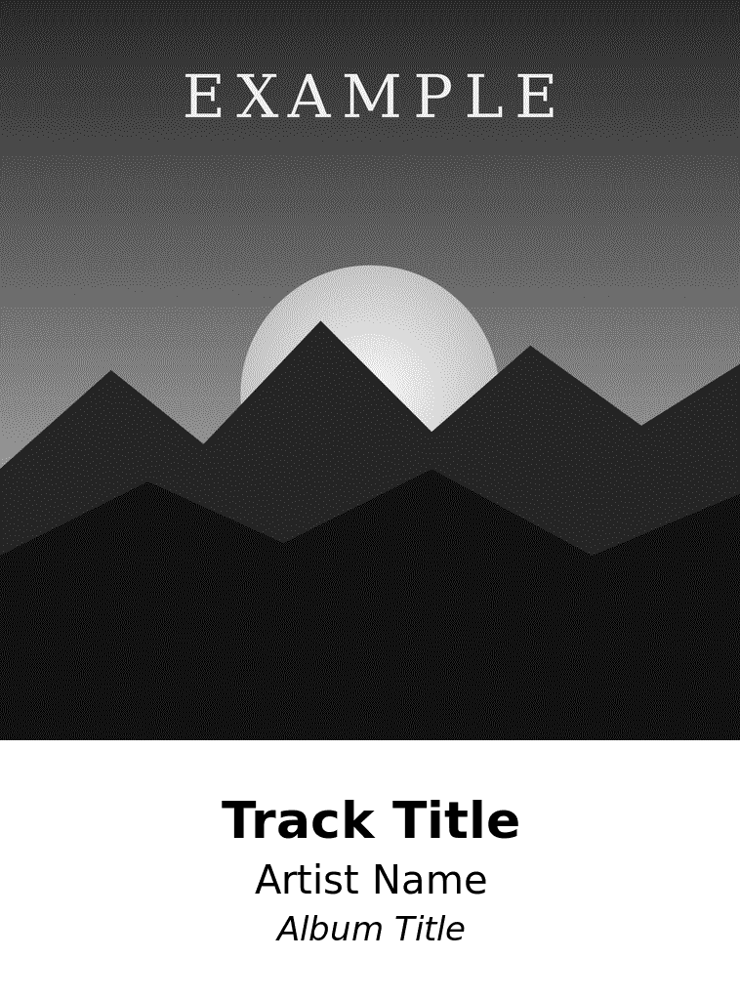
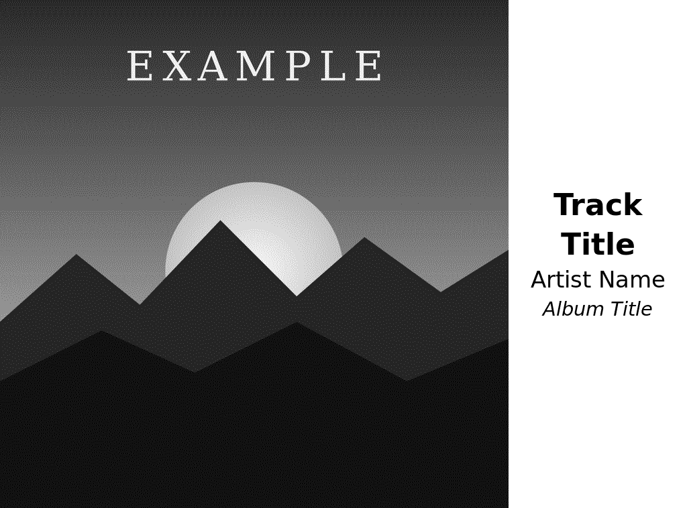

# A short note about Vibe Coded Projects

This paragraph is being written by a human. Everything else below this section, and all code included was written by Claude (Opus 5.5 Extra) in October 2026. It was built for my purposes only, and it works for me. I'm making it available in case it's of use to anyone else for their projects. I am not a developer, and AI makes mistakes. Anything you use this for is done as at your own risk. Be careful!

# roon-inkplate

Shows what Roon is playing on an [Inkplate 6PLUS](https://soldered.com/) e-paper display: the album cover, dithered to the panel's 8 grey levels, with track, artist and album underneath. The frontlight comes on while music plays and fades out when it stops. Touch the panel to skip tracks, pause, change the volume or adjust the light.

<p align="center">
  
  &nbsp;&nbsp;
  
</p>

*Previews of the two layouts, rendered by the bridge's test mode from a made-up cover.*

## How it works

```
Roon core ──(Roon extension API)──▶ bridge ──(HTTP, Wi-Fi)──▶ Inkplate 6PLUS
                                      │                          │
                       renders 1024×758 frames,          polls every 2 s,
                       dithering, layout, text,          draws frames, runs
                       volume limits, light level        frontlight and touch
```

- **`bridge/`** is a Roon extension (Node.js). It watches a zone, fetches the cover, lays out the frame and dithers it, then serves it as a ready-to-draw 388 KB image. It answers `304 Not Modified` when nothing has changed, so polling is cheap. Run it in Docker or with plain Node on any machine on the same network as your Roon core.
- **`firmware/RoonInkplate/`** is the Arduino sketch for the Inkplate. It polls the bridge, streams new frames into the display, sets the frontlight and turns touch gestures into commands. All layout and tuning happen in the bridge, so you rarely need to reflash.

## Features

- Album art and track text, in portrait or landscape, in either orientation.
- Follows one zone you name, or whichever zone is playing.
- Frontlight fades up when a new cover is drawn and fades out after a configurable idle period. When idle, the panel either clears to white or keeps the last cover as an unlit print.
- Touch controls on the art and the text strip, with a frontlight pulse to confirm each command.
- A volume ceiling: swipe-up never raises the volume above a level you set.
- Recovers on its own from Roon Server restarts, network drops and Wi-Fi outages.

## Requirements

- An **Inkplate 6PLUS**, either the Soldered version or the original e-radionica one. Other Inkplate models aren't supported, because the frame size, frontlight and touch handling are specific to the 6PLUS.
- **Roon** with a core on your local network.
- A machine to run the bridge: anything with **Docker**, or **Node.js 20.9 or later**. It's light enough for a Raspberry Pi running a 64-bit OS.
- The **Arduino IDE** (2.x) to flash the Inkplate.
- A **2.4 GHz** Wi-Fi network for the Inkplate.

## Quick start

### 1. Run the bridge (Docker)

```sh
git clone https://github.com/mbdmbd/roon-inkplate.git
cd roon-inkplate/bridge
docker compose up -d --build
docker compose logs -f
```

The compose file assumes Roon runs on the same machine as Docker. If it doesn't, set `ROON_HOST` in `compose.yaml` to the Roon core's IP address (see [Connecting to Roon](#connecting-to-roon)).

In Roon, open **Settings → Extensions** and **Enable** "Inkplate Now Playing".

Then check it from a browser:

- `http://<bridge-ip>:8765/status` lists your zones and their states. Put your zone's exact name in `ZONE_NAME` (see [Configuration](#configuration)) and run `docker compose up -d`.
- `http://<bridge-ip>:8765/preview.png` shows what the panel will display, upright.

### 2. Flash the Inkplate

1. In the Arduino IDE, open **Settings** and add this to **Additional boards manager URLs**:
   ```
   https://github.com/SolderedElectronics/Inkplate-Board-Definitions-for-Arduino-IDE/raw/refs/heads/main/package_Inkplate_Boards_index.json
   ```
2. In **Boards Manager**, install **Soldered Inkplate Boards**. In **Library Manager**, install **InkplateLibrary**.
3. Open `firmware/RoonInkplate/RoonInkplate.ino`. Copy `config.example.h` to `config.h` in the same folder and fill in your Wi-Fi details and the bridge's address. Give the bridge machine a fixed IP (a DHCP reservation) and use the IP rather than a `.local` name. If you set a `CONTROL_TOKEN` on the bridge, put the same value in `config.h` (see [Security](#security)).
4. Under **Tools → Board → Soldered Inkplate Boards**, choose **Soldered Inkplate 6PLUS**, or **e-radionica Inkplate 6PLUS** for the original crowdfunded board.
5. Connect the Inkplate by USB with a data cable, switch it on with the power button on its edge, choose its port under **Tools → Port**, and click **Upload**. No buttons need holding. On Windows, if the board appears under "Other devices", install the [CH340 driver](https://soldered.com/blogs/learn/ch340-driver-installation).
6. Open the **Serial Monitor** at 115200 baud and play something. You should see `bridge: new frame` and the cover should appear.

Compiler warnings from the board package are normal; it has compiled if the output ends with `Sketch uses … bytes`.

## Touch controls

Directions are as you look at the panel. Each control only responds within its own area.

| Where | Gesture | Does |
|---|---|---|
| Album art | tap | play / pause |
| Album art | swipe left | next track |
| Album art | swipe right | previous track |
| Album art | swipe up | volume up by `VOLUME_STEP`, never above `VOLUME_MAX` |
| Album art | swipe down | volume down by `VOLUME_STEP` |
| Text strip | tap | frontlight on / off |
| Text strip | swipe up | frontlight brighter by `LIGHT_STEP` |
| Text strip | swipe down | frontlight dimmer by `LIGHT_STEP` |

After a playback or volume command, the frontlight gives a quick pulse to show the bridge carried it out. No pulse means the bridge refused it, for example when the volume is already at the ceiling or "next" is pressed at the end of the queue. The serial monitor logs every gesture with its coordinates and the result.

Swipes made while the panel is downloading and redrawing a new cover (a couple of seconds) may be missed.

## Configuration

Every setting is an environment variable. All of them are listed, with defaults and comments, in [`bridge/compose.yaml`](bridge/compose.yaml). After changing one, run `docker compose up -d`; you don't need `--build`. Settings are checked at startup: if one is invalid, the bridge exits and the log says which and why.

Rather than editing `compose.yaml`, put your own values in `bridge/compose.override.yaml`. Docker Compose merges it automatically, and it's ignored by git, so `git pull` never conflicts with your settings:

```yaml
services:
  roon-inkplate:
    environment:
      ZONE_NAME: "Living Room"
      FRONTLIGHT: "15"
```

| Variable | Default | Meaning |
|---|---|---|
| `ZONE_NAME` | empty | Exact Roon zone name, as shown at `/status`. Empty follows whichever zone is playing. |
| `IDLE_GRACE_SEC` | `120` | Seconds paused or stopped before the panel goes idle. |
| `IDLE_MODE` | `blank` | `blank` clears the panel to white when idle; `keep` leaves the last cover showing, unlit. |
| `LAYOUT` | `portrait` | `portrait` puts the art above the text; `landscape` puts it to the left. |
| `ROTATE` | `90` | Portrait only. Use `270` if the image is upside down for how you stand the panel. Touch follows it. |
| `GAMMA` | `1.0` | Tone curve applied before dithering. Values above 1 lighten midtones. |
| `SHOW_TEXT` | `1` | `0` hides the track text. |
| `FONT` | `Sans` (`DejaVu Sans` in Docker) | Any installed font family. |
| `FRONTLIGHT` | `20` | Starting frontlight level while playing, 0–63. Touch adjusts it from there. |
| `LIGHT_STEP` | `5` | Frontlight change per swipe in the text strip. |
| `VOLUME_STEP` | `5` | Volume change per swipe on the art, in the zone's units (usually dB). |
| `VOLUME_MAX` | `-30` | Swipe-up never raises the volume above this, in the zone's units. If the volume is already above it, swipe-up does nothing. For zones that use a 0–100 scale, set something like `50`. |
| `ROON_HOST` | empty | Connect directly to this Roon core instead of using discovery. Needed in Docker. |
| `ROON_PORT` | `9330` | The core's extension port when `ROON_HOST` is set. |
| `CONNECT_TIMEOUT_SEC` | `20` | Abandon a connection attempt that gets no answer, and retry. |
| `CONTROL_TOKEN` | empty | Optional shared secret required for touch commands. Set the same value in the Inkplate's `config.h`. |
| `ALLOWED_HOSTS` | empty | Extra host names allowed in requests, comma-separated. IP addresses, `localhost` and `.local` names are always allowed. |
| `PORT` | `8765` | The bridge's HTTP port. |

Frontlight changes made by touch are saved in `display-settings.json` in the bridge's working directory (the `/data` volume under Docker). Changing `FRONTLIGHT` resets the level to the new value.

The Inkplate's own settings in `config.h` cover only the connection: Wi-Fi, the bridge URL, the poll interval, and timeouts for a lost bridge or Wi-Fi.

## Tuning

**Gamma.** E-ink doesn't render grey levels evenly, and dark tones tend to crush, so `/preview.png` will look better than the real panel. Judge `GAMMA` on the panel itself. Restarting the bridge (`docker compose up -d`) redraws whatever is playing within about 10 seconds, so you can step through 1.0, 1.3 and 1.6 without waiting for a track change. Try a dark cover, a cover with a face on it and a pale one, and judge from where you normally sit, where the dithering blends into tone.

**Frontlight.** Judge it in the evening under your usual lighting, adjusting by swiping on the text strip.

**Test without Roon or the panel.** This renders any image to `preview.png`, plus `frame.bin` with the exact bytes the Inkplate receives:

```sh
cd bridge && npm ci
node bridge.js --test cover.jpg "Track" "Artist" "Album"
```

## Connecting to Roon

Roon's automatic discovery uses UDP multicast. That works when the bridge runs with plain Node or with Docker host networking, but not through Docker's default bridge network. The compose file therefore connects to the core directly:

- **Roon on the same machine as Docker:** `ROON_HOST: host.docker.internal`, the default. The `extra_hosts` line makes this name work on Linux as well as on Docker Desktop and OrbStack.
- **Roon on another machine:** set `ROON_HOST` to that machine's IP address.
- **Plain Node, or Docker with `network_mode: host`:** leave `ROON_HOST` empty and discovery finds the core.

Roon normally uses port 9330 for extensions, but it can move to another port in 9330–9339 after an upgrade or restart. To find the current one on the Roon machine, run:

```sh
bash -c 'for p in $(seq 9330 9339); do printf "%s " $p; curl -s -o /dev/null -m 2 -w "%{http_code}\n" "http://localhost:$p/display/"; done'
```

The port that returns `200` is the one to use.

## Running without Docker

```sh
cd bridge
npm ci
ZONE_NAME="Your Zone" node bridge.js
```

To keep it running, use one of the service files in [`bridge/examples/`](bridge/examples):

- `roon-inkplate.plist`: a macOS LaunchAgent.
- `roon-inkplate.service`: a systemd unit for Linux, including Raspberry Pi.

Each file has instructions at the top. Run the bridge from the `bridge` folder: the Roon pairing token is saved in `config.json` in the working directory. Keep that file private (it's in `.gitignore`).

## HTTP API

The Inkplate uses these endpoints, and they're also handy for debugging or your own clients.

| Endpoint | Purpose |
|---|---|
| `GET /frame` | The current frame: 388,096 bytes, 1024 × 758 pixels in native panel order, two pixels per byte with the high nibble first, values 0 (black) to 7 (white). Send `If-None-Match` to get `304` when the image is unchanged. Both 200 and 304 responses carry `X-Frontlight` (0–63), `X-Layout` and `X-Rotate`, so light changes never force an e-ink refresh. |
| `POST /control?action=…` | One of `playpause`, `next`, `previous`, `vol_up`, `vol_down`, `light_toggle`, `light_up`, `light_down`. Returns `200` if carried out, or `409` with a JSON reason if refused (for example, volume at the ceiling). Also `400` for an unknown action, `401` for a missing or wrong `X-Control-Token`, and `403` for requests from a web browser. |
| `GET /preview.png` | What the panel should be showing, upright. |
| `GET /status` | JSON: zones and their states, what's shown, light level and active configuration. |

```sh
curl -X POST "http://localhost:8765/control?action=vol_down"
# with a token:
curl -X POST -H "X-Control-Token: $TOKEN" "http://localhost:8765/control?action=vol_down"
```

Any endpoint returns `421` if the request's `Host` isn't an IP address, `localhost`, a `.local` name or listed in `ALLOWED_HOSTS`.

## Security

The bridge is built for a trusted home network. Don't publish its port to the internet. Out of the box:

- **Web pages can't send commands.** `/control` refuses any request a browser sends, so a malicious site open on a phone or laptop on your network can't pause, skip or change the volume.
- **Web pages can't read the bridge either.** The `Host` check blocks DNS-rebinding attacks against all endpoints.
- **The volume ceiling is enforced by the bridge**, and invalid settings stop it from starting rather than weakening the ceiling.
- **Track text is sanitised** before rendering, because internet radio stations control what it says.

To also stop other devices on your network from sending commands, set a token:

1. Generate one: `openssl rand -hex 16`.
2. Set it as `CONTROL_TOKEN` in `compose.yaml` and run `docker compose up -d`.
3. Set the same value as `CONTROL_TOKEN` in the Inkplate's `config.h` and upload again.

The display endpoints (`/frame`, `/status`, `/preview.png`) stay readable on your network, so the Inkplate can poll without a token.

The Docker setup runs as a non-root user with no Linux capabilities and a read-only root filesystem. The systemd example applies equivalent sandboxing.

The Inkplate stores its Wi-Fi password and token unencrypted in flash, so anyone with physical access can read them. If that matters to you, put the Inkplate on an IoT or guest network that can only reach the bridge.

See [SECURITY.md](SECURITY.md) for design notes and how to report a vulnerability.

## Troubleshooting

**The extension doesn't appear in Roon.**
- Check `docker compose logs`. Repeated `connecting to Roon core…` lines mean the bridge can't reach the core: check `ROON_HOST` and `ROON_PORT` (see [Connecting to Roon](#connecting-to-roon)).
- Roon only lists extensions that are currently connected. After a Roon Server restart, the bridge reconnects by itself once the core has finished starting.

**The panel never updates.**
- From a phone on the same Wi-Fi, open `http://<bridge-ip>:8765/status`. If that fails, a firewall on the bridge machine is blocking port 8765.
- Check the serial monitor. A run of `bridge: HTTP -1` lines means the Inkplate can't reach the bridge, so check `BRIDGE_URL` in `config.h`.

**A code change doesn't take effect.** After replacing `bridge.js`, run `docker compose up -d --build`; a plain `up -d` keeps the old image. In the build output, the `COPY … bridge.js` step should not say `CACHED`.

**`invalid use of member function` errors in the Arduino IDE.** These come from an older InkplateLibrary. `inkplate_compat.h` handles v10 and v11, so make sure it's in the sketch folder. Updating to the latest library and board package also fixes it.

**The serial port won't open, or the upload fails.** Try another USB cable (many are charge-only), quit other apps that may hold the port, and set **Tools → Upload Speed** to 115200.

**Touch commands stopped working after setting a token.** The serial monitor shows `control …: HTTP 401`. The `CONTROL_TOKEN` in `config.h` must exactly match the bridge's; reupload after changing it.

**The browser shows an empty page or error 421.** You opened the bridge by a host name that isn't allowed. Use its IP address or a `.local` name, or add the name to `ALLOWED_HOSTS`.

**The container keeps restarting.** A setting is probably invalid. `docker compose logs` starts with `Invalid configuration:` and lists the problems.

**Touches go the wrong way.** The bridge sends its `LAYOUT` and `ROTATE` settings to the Inkplate, so touch follows the image. Tap the top-left of the art: the serial monitor should log `touch: art` with small coordinates.

## Tested with

- Inkplate 6PLUS with InkplateLibrary 11.2 and Soldered Inkplate Boards 4.0 (it also compiles for the e-radionica board).
- Roon 2.x.
- The bridge in Docker on macOS (Node 24, sharp 0.35).

Reports from other setups are welcome; please open an issue.

## Acknowledgements

- [node-roon-api](https://github.com/RoonLabs/node-roon-api) by Roon Labs.
- [Inkplate Arduino library](https://github.com/SolderedElectronics/Inkplate-Arduino-library) by Soldered Electronics.
- [sharp](https://sharp.pixelplumbing.com/) for image processing.

This project isn't affiliated with or endorsed by Roon Labs or Soldered Electronics. Roon and Inkplate are trademarks of their respective owners.

## License

[MIT](LICENSE)
